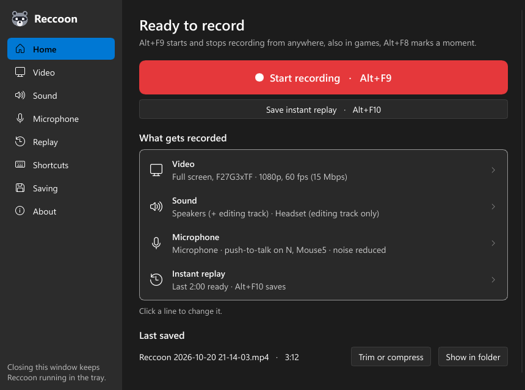
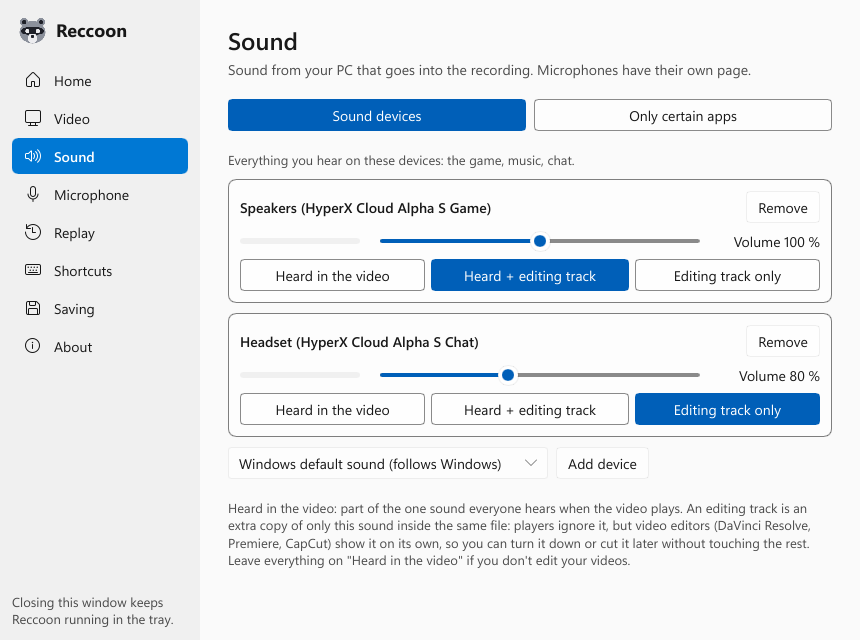
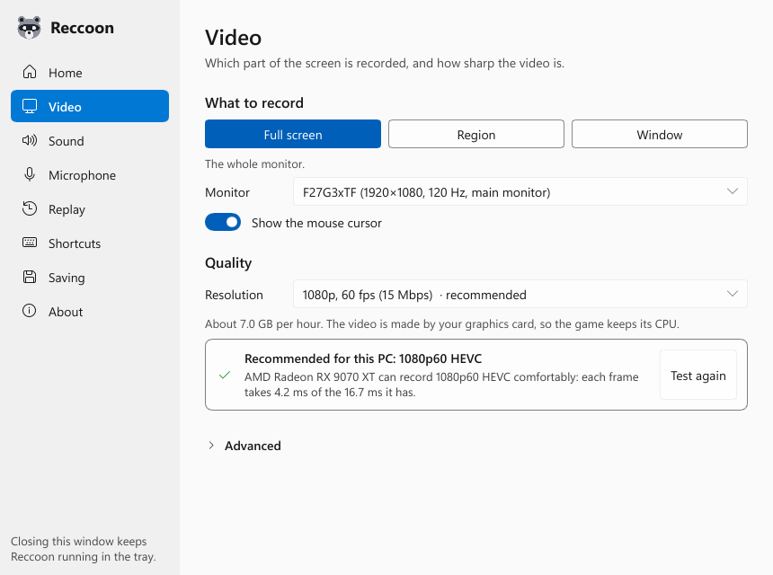

<p align="center">
  
</p>

<h1 align="center">Reccoon</h1>

<p align="center"><b>Steals the moment, not your FPS.</b></p>

<p align="center">
A free screen recorder for Windows that barely touches your PC.<br>
Built for gamers on CPU-heavy games (GTA RP / FiveM, Rust, Tarkov, modded Minecraft) and on older PCs,
where other recorders cost frames and cause stutter.
</p>

<p align="center">
  
</p>

## Why it's light

- **The GPU does the work.** The screen is captured, scaled and encoded on the graphics card (AMD, NVIDIA
  or Intel hardware encoder). Frames never travel through the CPU.
- **Nothing runs while you wait.** In the tray Reccoon uses 0 % CPU and under 1 MB of memory: no timers,
  no polling. The window is closed and freed when you close it.
- **No injection.** Reccoon never hooks into games. It records the screen the way Windows itself does
  (Windows Graphics Capture), so it's safe with anti-cheat.
- **The game always wins.** If a game needs the whole GPU and the recording falls behind, Reccoon records
  fewer frames for a while instead of slowing the game down.

Measured on a Ryzen 7 9800X3D with a Radeon RX 9070 XT:

| | CPU | Memory |
|---|---|---|
| Recording 1080p 60 fps (HEVC, hardware) | 0.2–0.4 % | 10–15 MB |
| Waiting in the tray | 0.00 % | 0.6 MB |
| Shortcut to recording | under 1 s | |

## Features

- **Quality:** 720p, 1080p, 1440p or 4K (2160p) at 30, 60 or 120 fps, up to what your monitor shows.
  HEVC, H.264, or AV1 on the newest graphics cards; set the bitrate yourself if you like.
  A 10-second test on first start picks the best quality for your PC.
- **Two versions in one app:** *Low-end PC* keeps everything as light as possible; *High-end PC* adds
  a blurred-wallpaper look and animations. Switch any time on the About page.
- **What to record:** a whole monitor, a region you draw, or one window (even when it's covered). Cursor on or off.
- **Several sound devices at once:** e.g. HyperX *Game* and *Chat* together, each with a level meter and volume.
- **Only certain apps:** record the game and Discord but not Spotify.
- **Microphone** with push-to-talk on any number of keys and mouse buttons (hold or toggle), so the first
  and last word aren't cut, plus noise suppression (RNNoise) and a noise gate.
- **Editing tracks:** any source can also get its own track in the file, so a video editor can turn Discord
  down later. Players play the main sound.
- **Instant replay:** keeps the last 30 s to 5 min, in memory or (to save RAM) on disk. A shortcut saves
  it, also while recording.
- **Markers:** a shortcut marks a moment; markers become chapters in the video.
- **Crash-safe:** if the PC freezes or loses power, everything recorded until then still plays.
- **Captures:** every video Reccoon saved, by month, with a picture of each: play, trim or compress,
  show in folder, or delete to the Recycle Bin.
- **Trim and Compress for Discord:** keep part of a video without re-encoding, or make it fit 10, 50 or 500 MB
  (Discord's limits). Then *Copy* and paste it straight into Discord.
- **Doctor:** plain-language warnings, e.g. a muted microphone, a nearly full drive, recording to a hard
  disk, a GPU at 100 %.
- Tray icon (red while recording), shortcuts that work in games, small on-screen messages that never take
  focus and never show up in recordings.

<p align="center">
  
  
</p>

## Requirements

- Windows 10 version 2004 or newer, or Windows 11 (64-bit)
- A graphics card with a hardware video encoder: AMD, NVIDIA or Intel from roughly 2014 on

## Install

Download from the Releases page:

- **Reccoon-x.y.z-setup.exe**: installs for your user (no admin needed) with a Start menu shortcut and,
  if you like, starting with Windows.
- **Reccoon-x.y.z-portable.zip**: unzip anywhere and run `reccoon.exe`.

Reccoon isn't code-signed yet, so Windows SmartScreen may say *"Windows protected your PC"*. Click
**More info**, then **Run anyway**.

## Using it

Opening Reccoon shows its window; closing the window keeps it running in the tray (and when it
starts with Windows, it waits there). Click the tray icon to open the window; right-click it for a menu.

| Shortcut | |
|---|---|
| **Alt+F9** | Start / stop recording |
| **Alt+F10** | Save instant replay |
| **Alt+F8** | Add a marker |
| **Alt+F7** | Pause / resume |

You can change them on the Shortcuts page. Recordings go to `Videos\Reccoon` (change it on the Saving page)
and are named like `Reccoon 2026-10-20 21-14-03.mp4`.

Everything you've saved is on the **Captures** page, by month. To trim or compress a video, use
**Trim or compress** there or next to the last saved recording on Home, or right-click the tray icon
and choose **Trim or compress a video…**.

### Command line

`reccoon-cli.exe` does the same from a terminal, for scripts:

```
reccoon-cli --list                                  monitors, windows, sound devices, apps, encoders
reccoon-cli --record 60 --preset 1080p60            record a minute
reccoon-cli --compress clip.mp4 --size 10           fit a video into 10 MB
reccoon-cli --trim clip.mp4 --from 0:20 --to 1:05   keep part of it, without re-encoding
reccoon-cli --doctor                                check for problems
reccoon-cli --help                                  everything else
```

## FAQ

**Is it safe with anti-cheat?**
Reccoon never injects into or reads from game processes. It captures the screen with Windows' own capture
API, like the Snipping Tool, and reads keys for push-to-talk with Windows' standard Raw Input.

**Why HEVC? And AV1?**
HEVC (H.265) looks better than H.264 at the same size, especially on older AMD cards like the RX 580.
Reccoon uses it when your graphics card can encode it. Newer cards (Radeon RX 7000+, GeForce RTX 40+,
Intel Arc) can also record AV1: the sharpest picture at a given size (Video page, Advanced).
If a program can't play your recordings, choose H.264 there. Compress for Discord always makes H.264,
which plays everywhere.

**How do I record HyperX Game and Chat (or any two devices)?**
On the Sound page, add both devices. Each is heard in the video. Choose *Heard + editing track* for the
chat if you want to turn it down later in an editor.

**How do I set push-to-talk for FiveM (N for local, U for radio)?**
On the Microphone page, turn on push-to-talk and add both keys. Your voice is recorded while either is held,
and the keys still work in the game.

**My recording is black.**
Protected video (Netflix and similar) always records black. A few games in exclusive full screen do too:
switch the game to borderless or windowed full screen.

**Where are the settings and logs?**
Settings: `%APPDATA%\Reccoon\settings.json`. Logs: `%LOCALAPPDATA%\Reccoon\logs`. Uninstalling keeps your
settings and recordings.

**Does Reccoon send anything to the internet?**
No. It has no updater, accounts, telemetry or ads, and never uploads your recordings. See
[PRIVACY.md](PRIVACY.md).

## Problems and security

Bugs, ideas and questions are welcome as [issues](https://github.com/MrTabaOfficial/Reccoon/issues).
If something went wrong, attach your log from `%LOCALAPPDATA%\Reccoon\logs`. Please report security
problems privately, as [SECURITY.md](SECURITY.md) describes.

## Licence

Reccoon is free to use for personal and commercial purposes, including videos you earn money with.
It is **not open source**: the source code isn't published, and Reccoon may not be sold, changed,
reverse engineered or offered for download anywhere but this page. Your recordings are always yours.
The full terms are in the [licence agreement](LICENSE), which the installer also shows.

© 2026 MrTabaOfficial. All rights reserved.

Reccoon includes open-source libraries, listed with their licences in `THIRD-PARTY-NOTICES.txt`
(next to `reccoon.exe`, and with every release). The windows are made with [Slint](https://slint.dev),
used under its royalty-free licence:

<a href="https://slint.dev">
  <picture>
    <source media="(prefers-color-scheme: dark)" srcset="https://raw.githubusercontent.com/slint-ui/slint/master/logo/MadeWithSlint-logo-dark.svg">
    
  </picture>
</a>
